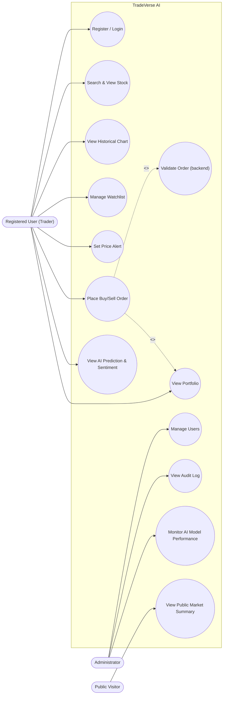

# TradeVerse AI — Use Case Diagram

**Version 0.1 — Week 1 Draft**

This document describes the actors and use cases for the TradeVerse AI MVP, and maps each use case to its corresponding functional requirement in `TradeVerseAI_proposal-srs.docx`. The rendered diagram is available as `usecase diagram.jpg` and `use_case diagram.html`.

## Actors

| Actor | Description |
|---|---|
| **Registered User (Trader)** | A user with an account who trades virtually, manages a watchlist, and reviews portfolio and AI insights. |
| **Administrator** | Manages user accounts, reviews audit logs, and monitors AI model performance. |
| **Public Visitor** | An unauthenticated visitor who can browse the public market summary without an account. |

## Use Cases

| Use Case | Primary Actor | Related Requirement |
|---|---|---|
| Register / Login | Registered User | REQ-UM-01, REQ-UM-03, REQ-UM-04 |
| Search & View Stock | Registered User | REQ-MD-01, REQ-MD-02, REQ-MD-03 |
| View Historical Chart | Registered User | REQ-MD-04 |
| Manage Watchlist | Registered User | REQ-MD-05 |
| Set Price Alert | Registered User | REQ-AL-01, REQ-AL-02 |
| Place Buy/Sell Order | Registered User | REQ-TE-02 |
| Validate Order (backend) *«include»* | *(system)* | REQ-TE-03, REQ-TE-04 |
| View Portfolio *«include» from Place Order* | Registered User | REQ-PF-01, REQ-PF-02, REQ-PF-03 |
| View AI Prediction & Sentiment | Registered User | REQ-AI-01, REQ-AI-02, REQ-AI-04, REQ-AI-06 |
| View Public Market Summary | Public Visitor | REQ-TP-01, REQ-TP-02 |
| Manage Users | Administrator | REQ-AD-01 |
| View Audit Log | Administrator | REQ-AD-02 |
| Monitor AI Model Performance | Administrator | REQ-AD-03 |

## Relationships

- **Place Buy/Sell Order** `<<include>>` **Validate Order (backend)** — every order submission is validated server-side before execution; this is not optional.
- **Place Buy/Sell Order** `<<include>>` **View Portfolio** — a successful order always updates the holdings and balance shown in the portfolio view.

## Diagram (Mermaid source)

> GitHub renders Mermaid diagrams natively in Markdown preview. If it does not render in your viewer, open `use_case diagram.html` instead, or view `usecase diagram.jpg`.

## Notes

- This diagram covers the MVP scope only (Sections 3.1-3.8 of the SRS). Future-scope use cases (e.g., real brokerage integration) are intentionally excluded, matching Section 1.3 of the SRS.
- Field-level interaction detail (screen flows, wireframes) is out of scope for this diagram; see the Week 2 wireframe deliverables for that level of detail.
